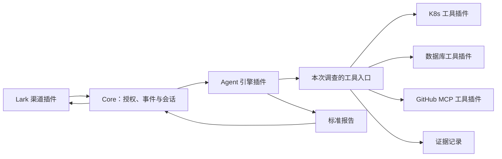

# Design

## Context

本 change 的起点只有 TypeScript 开发、类型检查和构建配置及空入口，没有既有接口或持久化数据需要兼容。产品范围见 [proposal.md](./proposal.md)，实施进度见 [tasks.md](./tasks.md)；尚未接入真实集群、数据库、GitHub 或 Lark。

已确认的约束是：所有具体接入通过插件完成；首版使用 Codex、K8s、通用数据库组件、GitHub MCP 和 Lark；连接设置和凭证来自文件；每次调查绑定目标；生产变更不开放。

## Goals / Non-Goals

**Goals:**

- 新增引擎、工具或消息平台，通过实现插件合同和增加配置接入，无须修改 Core。
- Core 不识别厂商名称、K8s 资源类型、数据库方言或 Lark 消息结构。
- 一次调查的资源范围、会话、证据和消息回传位置可以追踪，并在并发及恢复时保持一致。
- 优先封装成熟 SDK 和 MCP 服务，自研范围集中在插件组合、目标绑定和调查协调。

**Non-Goals:**

- 首版不提供插件市场、运行中热插拔或不受信任插件代码的沙箱。
- 不实现另一套 Agent 推理循环，不在 Core 固定排障步骤或解释各数据库的系统表。
- 首版采用单服务实例和本地持久化；不承诺跨实例调度或聊天平台的端到端 exactly-once 投递。

## Decisions

### 1. 单项目起步，以公开插件合同划分边界

先保留一个 npm 项目，设置三个代码边界：

| 边界 | 职责 |
| --- | --- |
| `plugin-api` | 插件清单、能力合同、平台独立的请求、事件、证据和报告类型 |
| `core` | 配置校验、插件注册和生命周期、目标绑定、调查协调、记录及消息路由 |
| `plugins` | 首批执行引擎、工具和渠道实现，以及随插件提供的知识资料 |

插件可来自已安装 npm 包或本地 ESM 模块；入口由受信任配置指定，启动时加载，不根据聊天内容安装或加载代码。内置插件与外部插件使用同一注册路径。Core 只能依赖 `plugin-api`，不能导入具体插件；引擎 SDK、业务 SDK 和厂商协议留在插件内部。

插件清单至少声明模块 `id`、合同版本、提供的能力类型、配置 Schema 和可选 Skills。模块 ID 表示实现身份，组合清单中的键表示配置实例 ID；同一模块可创建多个实例，`AgentEngine` 等能力类型也可由多个实例提供。工具内部注册键是 `(instanceId, localToolName)`，只拒绝重复实例 ID 或同一实例内重复的局部名称，不对能力类型或跨实例工具名做全局排重。引擎插件为工具生成合法、稳定、无冲突的可见别名，维护其到内部注册键和本轮绑定的映射；恢复时重建同一映射，遇到冲突明确失败，不覆盖旧注册。

Core 校验清单及配置后注册能力，再启动渠道；停机时先停止接收请求，再结束调查并释放插件资源。未知合同版本、命名空间冲突、缺失插件和非法配置均使启动检查失败。静态配置有效但数据源不可达属于可观测的运行故障，不作为全宿主配置错误，也不切换到其他资源。

渠道启动接收取消信号，`stop` 必须能取消未完成的启动，停止和实例释放均须幂等。关闭先取消并停止渠道，再等待启动结果，不能先无限等待连接握手。生命周期等待由 `lifecycleTimeoutMs` 限制（默认 10000，范围 1–60000）；超限明确报告清理失败并继续释放其他实例。启动迟到完成时再次停止和清理该实例，关闭后的渠道消息入口拒绝新输入，不能只超时放弃后允许重新注册接收。

选择启动时模块加载，是为了支持独立扩展并保持首版部署简单。暂不拆分多个发布包；出现独立分发需求时，公开合同可抽成插件 SDK，不改变业务消息和目标配置的语义。

### 2. 三类运行能力，知识资料随需组合

| 能力合同 | 插件提供的行为 | Core 负责的边界 |
| --- | --- | --- |
| `AgentEngine` | 新建或恢复会话、执行一轮调查、输出标准事件、响应取消 | 目标及工具绑定、同一事件串行执行、预算、会话记录 |
| `ToolProvider` | 声明工具 Schema、按范围创建本轮独占绑定或报告本轮不可用、执行查询、响应取消和关闭 | 实例命名空间、绑定身份校验、可用性状态、调用计量、超时、证据编号和结果规模上限 |
| `MessageChannel` | 接收并验证平台消息、转为标准输入、发送或更新回复并返回标准投递回执 | 发起人和目标授权、进出站消息关联、持久化去重及结果路由 |

工具合同既能封装原生 TypeScript SDK，也能代理现有 MCP；首批 K8s、数据库和 GitHub 查询全部复用现成 MCP。MCP 连接和桥接复用官方 SDK，不自行实现协议栈。插件做配置装配、范围检查、生命周期和证据转换，不逐个重写上游查询能力。外部 MCP 的认证参数留在工具插件侧；Agent 仅连接本次调查的受限工具入口。

入口按绑定列举和调用允许的工具，不透传上游所有 JSON-RPC、prompts 或 resources 能力。工具允许清单由受信任配置确定，不能只凭 `readOnlyHint` 自动纳入新工具。固定上游版本并校验工具名称与 Schema；后端变更清单时不能扩大正在运行的绑定，缺失或不兼容工具明确失败。公共 MCP 传输与证据记录只实现一次，数据源插件仅补充各自必要的参数范围校验和结果策略。

Skills 是可随插件或目录提供的知识包，记录系统背景、排障方法和证据要求；由引擎插件转换到其支持的技能加载方式。Skills 不负责强制授权。工具描述和 Schema 必须足以让 Agent 发现能力，不把所有工具调用顺序写入 Core。

引擎接收的工具合同与 MCP 传输配置分离：Codex 插件将绑定后的工具暴露为 MCP，未来引擎也可以映射成自己的工具调用形式。这样新增引擎不要求改写 K8s 或数据库插件。

### 3. 配置按共享运行入口与排障目标组织

日常配置采用一份 `config.yaml`，集中声明默认 `agent`、`channels` 中的连接和授权路由、目标名到独立文件的映射以及可选运行限制。每个目标文件集中声明扁平 `tools` 列表和知识；每项显式包含稳定 `name` 和 `plugin/config` 或 `use`，名称只标识实例，不作为分类或厂商判断；需要特殊引擎时可覆盖默认 agent。同一目标可以有不同种类的工具，也可创建多个同插件实例。工具按目标作用域生成稳定实例身份，调整文件位置或映射顺序不改变连接归属。

```yaml
# private/config.yaml
version: 1
agent:
  plugin: codex
  config:
    model: REPLACE_MODEL
    apiKey: REPLACE_KEY
targets:
  prod-a: ./targets/prod-a.yaml
channels:
  lark:
    plugin: lark
    config:
      appId: cli_0000000000000000
      appSecret: REPLACE_SECRET
      # tenantId和botOpenId选填，分别作为租户限制和自动查询覆盖。
    routes:
      - tenant: tenant-a
        conversation: chat-a
        allowedSenders: [user-a]
        targets: [prod-a]
# private/targets/prod-a.yaml
# tools:
#   - name: k8s
#     plugin: kubernetes
#     config: {kubeconfig: ../credentials/a.kubeconfig, context: a}
#   - name: orders-db
#     plugin: database
#     config:
#       source: {type: postgres, host: db-a, database: orders, user: reader, password: REPLACE_PASSWORD}
```

内置插件目录在应用装配层注册短名称，Core 只处理通用插件声明，不导入厂商实现、不维护厂商字段分支。自定义插件可以显式提供模块或在全局 `plugins` 注册别名。插件声明使用内联 `config`；确需外部插件配置时可显式使用 `configFile`，两者互斥，没有隐式查找。内置二进制、Node 可执行文件和插件状态目录由对应插件提供默认值，仍可显式覆盖；缺失时直接报错，不运行时下载安装。

`sharedTools` 是可选的显式共享声明，目标通过 `use` 引用。全局注册或声明共享工具本身不授予任何目标调用权限。普通目标内联工具实例彼此独立，不因本地名称或插件相同就共享。缺失共享引用、身份冲突、非法渠道/目标授权在创建资源前失败。

配置使用 YAML1.2 和严格 Schema 校验，连接设置与凭证可直接写在所属 config；kubeconfig、证书和凭证文件仍可引用。目标文件、插件模块、知识和配置内的文件路径统一相对于各自声明文件解析，正常化后才交给现有宿主。路径独立于 cwd；凭证值不进入目标快照或错误内容。插件显式使用内联值或凭证文件且恰好选一种，向统一脱敏器注册实际值。

新的入口格式替换先前“组合清单 + 每插件一个私有 YAML”的用户格式，不保留旧入口的隐式兼容分支。Core 归一化后继续使用通用实例/目标/路由合同，插件合同及按目标绑定策略不变。配置修改通过重启生效；凭证轮换不改变资源指纹，连接、资源范围和实现合同变化仍拒绝旧事件恢复。真实配置放在 Git 忽略的 private 目录；不为每个插件强制创建凭证文本文件。

### 4. 按目标绑定工具，按调查建立独立 Agent 会话

授权发生在创建调查前。只有请求目标属于该渠道、会话和发起人允许集合时，Core 才创建不可变 `InvestigationScope`，其中包含目标 ID、获准的插件实例、发起人、回传地址和配置范围版本。

全量配置只由可信宿主管理。每次创建或恢复 thread 前，宿主根据已绑定目标生成最小上下文和本轮工具清单：仅包含该目标的非敏感连接标识、获准资源和知识资料，不包含其他集群配置、全局目标索引或原始凭证。当前目标显式授权的共享数据库或仓库仍属于允许范围。线程身份持久绑定目标，不能通过追问、运行参数或引擎会话句柄切换到另一个目标；目标不一致必须新建事件，不能复用旧 thread。配置注入隔离与 Agent 能否任意访问宿主文件是两个不同约束，不能仅凭独立工作目录就宣称后者已成立。

工具绑定过程由插件将自己的允许资源解析成不可变执行上下文。Agent 可以在此范围内选择资源及查询参数，但不能提供另一个目标 ID、DSN、MCP 地址或任意凭证。Core 校验调用所属绑定，工具插件进一步校验资源选择器；数据库权限、K8s RBAC 和 GitHub Token 权限在底层提供实际约束。



首版每个活动调查轮次独占工具后端。运行时绑定键是 `(investigationId, turnId, pluginInstanceId)`：K8s、DBHub 和 GitHub MCP 各自创建本轮的后端进程、连接及 MCP 入口，仅装载绑定目标的配置；同一轮多次调用复用该绑定。两个事件即使使用同一个目标或配置实例，也不共享可关闭的后端。工具进程和句柄由本轮执行上下文持有，完成、失败或取消后统一释放；下一次追问重新绑定，Agent 的逻辑会话继续沿用。

绑定结果按数据源分别记录 `ready` 或 `unavailable`。目标服务不可达、认证被拒、MCP 启动超时等运行故障只使该数据源本轮不可用，释放其已创建资源；其他成功绑定仍交给 Agent 使用，并在上下文和报告中列明不可用数据源、失败阶段与证据缺口。失败不能伪装成空结果；仅作有预算的同目标重试，不更换连接或身份。无可用 MCP 时，声明 `supportsNativeTools` 的引擎仍能使用本地命令调查；否则生成缺失证据报告。原 MCP 的不可用信息始终保留，不能从输入日志推断出已确认根因。插件配置、工具合同或资源范围非法则拒绝该轮，不按普通不可用继续。

选择调查轮次独占，避免首版实现共享后端引用计数及跨调查取消协调。取消 A 时只中止 A 的调用、引擎执行和工具进程，不影响同目标 B。进程和数据库连接预算按活动轮次数计算，不能按不同目标数估算。K8s 后端直接使用上游 MCP 的 Kubernetes API 实现，不再引入 Node K8s 客户端或维护第二条查询路径。

#### Agent 配置隔离以防止串目标为验收边界

首版使用Codex原生权限限制模型本地文件访问，不要求每thread一个容器。Agent 自主选择已配置 MCP 或原生命令，可通过 SSH 登录目标环境查询，不逐条封装 kubectl、数据库或日志命令。CLI/SDK、宿主和已安装插件是受信任代码；插件进程分开用于隔离状态，不作为防御恶意插件的安全边界。

Codex 插件为每个调查建立专用 SDK 实例、配置和状态目录，显式传入环境白名单，只加载本目标的 MCP 清单和筛选后的知识资料；不继承操作者个人连接、项目配置、全局 Skills、插件或其他调查状态。恢复原 thread 时重新生成和核对这些绑定。生产凭证由对应 MCP 子进程持有，不放入 Codex 配置或输入；Codex 自身认证与每轮 MCP 入口调用凭证由可信引擎适配器管理，不作为模型可读材料。[官方 SDK 配置](https://learn.chatgpt.com/docs/codex-sdk#configuration-overrides)、[配置层级](https://learn.chatgpt.com/docs/config-file/config-basic)

首版验收针对配置装配及 MCP 工具路由，确保调查 A 时不会自动装配 B、接受 MCP 改绑 B 的参数或混入 B 的证据。Codex 默认启用 shell，可通过引擎配置 `localCommands: false` 显式关闭；本地图片、搜索、个人 App/插件和自动安装仍关闭。原生命令使用后述原生文件与socket权限，不经过MCP资源检查，远端账号权限仍独立管理；运行环境只部署所需凭证，远程账号权限按实际需求配置，不依赖 skill 或提示词形成权限隔离。目标SSH连接由引擎配置声明，排障约定通过knowledge/skills提供；私钥内容和路径不注入提示。

固定 SDK/CLI `0.166.0` 使用 `features.shell_tool = localCommands`，默认 true；`features.view_image = false` 保持关闭。历史验证的 shell 关闭结果仅代表旧配置。引擎通过公共 `recordEvidence` 回调上报 SDK 实际命令完成事件，由本轮宿主指定调查/目标身份、脱敏、限制结果规模并持久化；Codex 获得一个读取已捕获命令证据的 MCP 辅助入口，以取得真实证据编号。原生命令不使用 MCP 的参数预校验和单查询超时：总轮次及模型预算始终生效，命令调用和输出在 SDK 观测事件到达时计入预算，超限终止调查，不能宣称命令执行前拦截。Docker 镜像安装 OpenSSH 客户端，宿主直接运行时需自行提供 ssh。[配置参考](https://learn.chatgpt.com/docs/config-file/config-reference)

2026-11-01 的最小验证环境为 macOS arm64、Node `23.7.0`、SDK/CLI `0.166.0`，使用专用状态目录、环境白名单、临时 A/B 目录、本机模拟 Responses 接口和只提供 A 证据的 stdio MCP。模拟模型发送确定的调用，实际执行 SDK/CLI；没有真实模型推理或生产连接。严格配置检查下，A 的 MCP 查询成功，未注册 B 的 MCP 调用失败，shell 和图片工具调用失败；新建及恢复 thread 的 `apply_patch` 均能写入工作目录外的合成 B 目录。前者支持继续实现按目标装配与调用限制，后者是早期未启用权限档时的已知边界，已由本次原生权限档及新增apply_patch拒绝回归取代；历史结果不代表当前配置。真实 K8s/PG/GitHub 的 A/B 连接隔离仍由实施验收确认。

本轮 MCP 入口只监听受控本机地址，使用本轮独立短期调用凭证，绑定关闭即撤销；不暴露进程控制、任意地址连接或通用 JSON-RPC 转发。远程资源权限始终由目标绑定、工具检查和底层身份共同限制，与是否使用本地沙箱分别验证。

#### 目标本地技能包

目标文件新增可选 `skills: [../skills]`，路径相对该目标文件。每项可指向单个技能目录、SKILL.md 或包含技能的目录；目录扫描最多8层，发现SKILL.md后视为一个包，不继续把包内资料当作其他技能。校验name/description与同目标名称冲突，目标最多128个技能、8192个文件、64MiB包内容，单SKILL.md不超过256KiB；无技能的空集合允许加载，错误路径或非法包明确失败。

Core仅维护标准技能描述（名称、说明、源目录、内容摘要），不识别Codex内部格式。源包以稳定排序文件名、可执行标志和内容计算摘要，参与目标范围指纹。整个技能目录可由符号链接指定，但包内不接受符号链接、特殊文件或第二份嵌套SKILL.md，防止资源变成额外原生技能；.git和node_modules忽略、不复制、不计入摘要，避免隐式收集包外内容或已安装依赖。技能是管理员提供的可信文件，不由聊天输入安装。

Codex插件声明supportsSkills，并在每次新建/恢复会话前复核源包摘要，复制至该调查专用HOME/.agents/skills；从读取时保存的字节装配，保留普通文件及脚本执行标志。全部包准备好后替换原受管技能集合，去掉旧技能，不使用操作者个人技能目录。任何运行目录写入前，拒绝源技能与调查HOME、工作根或受管安装位置任一方向的包含关系，避免误删或污染源包；校验HOME和工作根的.agents/.codex父目录后清理其他技能发现位置。工作目录用独立git仓库边界阻止继承父仓库技能；Git仅初始化本地工作目录，不克隆或访问远端。无此能力的引擎遇到非空skills启动失败，不静默忽略。技能不经knowledge正文注入，Codex先发现元数据、按需读取正文与资源；Codex自带的系统技能仍保留。

agent.config保持插件私有，由agent.plugin对应的configSchema校验；不同引擎可以有不同配置项。目标skills声明可用技能包，具体装配方式由引擎实现，公共配置不暴露Codex安装路径或发现参数。

配置或源技能修改后重启加载；技能内容摘要变化会改变目标范围，不能用旧会话继续调查。启动到会话创建之间源文件变化则明确要求重启，不安装与已授权快照不一致的包。不执行依赖安装或初始化脚本，所需外部程序由部署环境提供。装配与访问控制分别验证，当前原生权限档只读授予已装配技能。

### 5. 首批插件选型与替换边界

#### 原生目录权限与独立SSH工具

Codex仅负责原生目录权限、认证和引擎会话。默认root deny/minimal read，当前work/tmp可写、装配技能及固定vendor只读；macOS拒绝公共scratch，Linux保留原生私有/tmp。额外目录解析规范路径并参与范围，拒绝受保护配置/认证/状态重叠及系统/PATH/Node/代码目录写入。SSH不再在引擎内启动agent或装配公有连接文件；移除旧SSH字段、Unix socket例外和Linux AF_UNIX地址族逃生开关。网络代理使用临时HTTP/SOCKS端口，原生命令不能访问其他本地socket。CLI先SIGINT合作取消，强杀保留清理不确定性。Docker仍需seccomp=unconfined支持非root原生bubblewrap，不回退全权限。

目标tools以name/plugin:ssh/config声明连接，每个实例只固定一台服务器，沿用现有组合、稳定别名、目标授权、证据及生命周期合同，无Core厂商分支。Codex的本轮investigation MCP桥仅装配当前已授权工具，enabled_tools固定本轮清单，并设置default_tools_approval_mode=approve供无人值守执行；不能用伪造readOnly=true避开原生审批，也不对外部MCP服务扩权。一个实例只有execute(command)通用工具，不实现命令清单、Shell分类器、隧道、SFTP或交互终端。工具readOnly改为boolean并原样桥接，SSH声明false；只读取证任务及远端账号授权仍独立落实，不把元数据宣称为强制写入保护。

服务端SSH实现复用ssh2@1.17.0（MIT，官方仓库最近维护元数据2026-05-13，安装时生产依赖审计0公告），仅在插件内部依赖；不污染公共证据/目标格式。库支持Node，浏览器不运行。可选原生优化失败时使用库正式JS路径，不引入自写SSH协议；替换库只影响插件，已有目标/证据无数据迁移。认证区分password、private-key及private-key+password，私钥可附passphrase；密码/口令直接值与文件互斥、私钥来自文件，路径相对声明文件并支持~/。启动校验解密与格式，宿主注册秘密脱敏，连接凭证不装配到模型。组合认证必须公钥阶段partial-success后再发账户密码，并拒绝仅一种方法即成功的策略不匹配；不尝试交互OTP或个人agent。

knownHostsFile继续由管理员提供。宿主用固定/usr/bin/ssh-keygen解析目标（含非默认端口/hashed条目），将普通主机密钥固定到库hostVerifier；撤销条目拒绝，CA证书条目不冒充已验证的直接主机密钥。不做首次自动信任。host/user/port、主机密钥摘要、认证模式进入scope，凭证值/文件内容不进入；普通轮换不改变身份。

每轮独占连接，绑定失败为该源unavailable。每实例同一时刻一个command，忙时明确失败；命令受插件及Core查询超时、字节与调用预算，输出以有界字节累计。超限丢弃候选输出并断开，避免截断到凭证中间；非零退出、缺失退出状态、连接丢失明确记录失败，可能已执行时remoteStatus=unknown。所有输出在进入模型前经插件与宿主脱敏，正常/失败/取消均关闭本地连接，不保证远端已停止。dev迁移为tools中的dev-server实例，删除仅为SSH重复的agent覆盖，更新skills为调用注册工具，保留私有原认证文件。

Codex配置保持apiKey/apiKeyFile兼容，增加authFile，三者严格互斥且必须显式选择。authFile解析已有Codex JSON：API Key缓存沿用原代理；ChatGPT缓存走原生openai provider，拒绝API baseUrl，支持~/展开和声明文件相对路径。认证文件限1MiB，错误不包含内容，敏感字段注册脱敏；范围包含认证方式及稳定账号摘要，不包含Token或其轮换摘要。

ChatGPT源文件仅作为bootstrap/reseed：按规范源路径选择服务持久化目录（plugins/.codex-auth/<路径摘要>），仅复制auth.json；源摘要标记相同时保留已刷新缓存，源文件重新登录后重启导入新缓存，不回写源文件。服务内同源认证实例共享该Codex HOME及其原生刷新协调，模块级引用计数保证初始化/清理不与活动会话竞争；未启动调查的配置检查不写入状态。独立调查仍有自己的HOME、Git工作目录及HOME/.agents/skills；服务认证HOME不装目标技能，初始化时清理其遗留发现目录。默认启动器传--ignore-user-config，忽略服务认证HOME配置，也不复制操作者配置。原会话与导入副本在两处同时刷新可能相互失效，长期服务建议独立登录；官方原生刷新失败时重新登录源文件再重启，不实现自己的OAuth刷新协议。

Codex的item.completed/agent_message可包含中途commentary，SDK事件类型不保证它就是最终结构化报告。适配器沿用SDK finalResponse语义，仅保存最后一条agent_message，等待整个流完成后再解析报告。ChatGPT模式先确认终态累计usage及预算，再做JSON/Schema校验；格式错误可在同一累计预算内修正。没有终态usage或已确认usage失败的会话禁止继续，但保留实际阻塞错误，不统一伪装为预算耗尽。API模式同样不能将中途消息或结束前候选报告当作已完成结果。

原生ChatGPT没有现有API预计数网关，使用SDK turn.completed的thread累计input/output；handle保存累计检查点，新Core轮以该检查点为基线，报告修正继续按同一基线取差额，不能逐次累加累计值。只有显式配置runtime.maxModelTokens时，缺失检查点、缺失终态usage、计数回退或超限明确失败，候选报告在终态用量检查前不交付；默认无Token上限，用量不完整标记complete=false，不阻止有效报告。中断后尚未确认的用量保守计入续接轮。此模式不能提供生成前Token硬限额，仍受Core轮次超时及工具预算限制。API Key模式的预计数与请求预留保持不变，两种语义写入范围和README。

REST作为独立channel插件注册短名rest，复用MessageHandler与OutboundMessage，Core不增加HTTP或渠道分支。配置host/port、token或tokenFile和固定tenantId/conversationId/senderId，默认只监听127.0.0.1:8080。每个实例代表一个受信调用身份，多身份按多个实例配置；请求只能提交消息内容、messageId、目标/事件/回复引用和已有控制动作，不能声明address或senderId。认证比较固定长度摘要，不通过URL传Token。

POST /messages返回202受理结果，业务拒绝返回422，格式/大小/媒体类型错误使用400/413/415，无效认证401，处理失败503且只返回固定错误码。请求体最多64KiB，并限制连接和请求读取时间；网络断开不撤销已持久化受理，客户端用同一messageId重试。GET /messages?after=0&limit=20按升序游标返回回复及nextCursor，每页最多100条；不提供任意会话参数。追问与cancel/status/continue/retry-delivery复用现有动作。

REST回复邮箱属于渠道传输持久化，位于宿主分配的插件状态目录，不另建调查状态。单实例最多10000条，每条最多128KiB，达到容量明确失败，不静默淘汰；调试数据由管理员停机后清理。出站幂等键对应固定文件，文件同步及目录同步后才返回回执；持久化序号支持跨重启分页，同键不同内容拒绝，发送失败可重试。更新以追加修订消息提供新游标。启动不发布监听端口直到邮箱恢复成功，停止取消未完成启动、关闭监听和现有连接，释放动作幂等。Docker默认不开放端口；REST启用时按README仅发布到宿主回环地址。

启动入口仍只需要--config路径；全局targets引用目标YAML，目标中的configFile、knowledge、skills及插件配置中的凭证引用按实际声明文件解析。README明确这条已实现的路径链，不新增隐式include、变量替换或目录自动扫描。

以下为 2026-11-01 的文档、发布元数据和公开安全记录核对基线，不表示依赖已经安装或通过生产验证。实现时固定包版本及容器镜像摘要，保留对应许可证和公告核对结果。

| 插件/组件 | 设计选型及核对基线 | 替换边界 |
| --- | --- | --- |
| Codex | 官方 TypeScript SDK `0.166.0`，Apache-2.0；映射到 `AgentEngine` | 事件和报告保持独立；引擎会话句柄作为插件私有值保存，新引擎从新事件开始 |
| Kubernetes | `containers/kubernetes-mcp-server` `v0.1.1`，Apache-2.0；本轮独占的本地 stdio MCP 后端 | 插件装配目标配置和策略；证据不依赖 Go 或 MCP 内部对象，不维护另一套 K8s 查询实现 |
| 数据库 | DBHub `1.5.0`，MIT，本轮独占 MCP 后端，首个验收数据库为 PostgreSQL | 连接和查询由工具插件持有；SQL 方言及数据库能力作为工具上下文暴露 |
| GitHub | 官方 MCP Server `v2.0.3`，MIT，采用本轮独占、受控的本地 stdio 后端 | 配置仓库身份和权限；证据保存 repo、commit、path 和链接，不保存服务内部对象 |
| Lark | 官方 `@larksuiteoapi/node-sdk` `1.76.0`，MIT；消息收发封装在渠道插件 | Core 保存不透明的平台身份和标准消息；更换渠道不会修改调查合同 |
| MCP 桥接 | 官方 TypeScript SDK 的 client/server 包 `2.4.0`，发布包元数据为 Apache-2.0 | 协议连接及传输集中封装；分发时保留所选版本实际许可证和第三方声明 |

这些组件均运行在服务端或受控子进程中，不进入浏览器；依赖版本和数据格式只在插件内部出现。依赖当前均有维护活动，但这不代表没有漏洞；公开公告、锁文件及目标环境的检查仍属于实施验收。

**Codex：**每个调查使用独立 thread，追问恢复原 thread；Core 保存 `{pluginInstanceId, sessionHandle}`，不解析其内部格式。生成专用的 Codex 配置和状态目录，使用明确的 MCP 清单，不继承操作者个人配置、插件、全局连接或生产环境变量。SDK 提供 thread 新建、继续及恢复能力，插件负责适配取消、失败及输出事件。[官方 SDK](https://learn.chatgpt.com/docs/codex-sdk)、[MCP 配置](https://learn.chatgpt.com/docs/extend/mcp)

**K8s：**复用上游原生 Kubernetes API 查询实现，不依赖 Agent 执行 kubectl。TypeScript 插件生成本轮私有 TOML，显式指定 `kubeconfig` 和 `cluster_provider_strategy = "kubeconfig"`，只提供单集群、单 context 及相关认证条目的 kubeconfig；不传全量多集群配置，不继承 `$KUBECONFIG`、默认用户目录或 in-cluster 自动选择作为回退。配置缺失或目标不符即失败。上游按固定二进制版本运行，不在请求期间下载安装。[版本及部署方式](https://github.com/containers/kubernetes-mcp-server/tree/v0.1.1)

后端仅装载当前目标的单集群kubeconfig，使用上游core工具集；不启用read_only、enabled_tools或denied_resources，不维护namespace/GVK/动作白名单。实际权限由该身份的Kubernetes RBAC决定。上游core集群操作工具完整透传，配置查看/切换工具集不装配，避免暴露宿主连接材料。未指定namespace的列表保留跨namespace语义；具体对象读取使用原kubeconfig默认namespace。MCP工具目录和readOnlyHint按上游发现，缺失标签按false处理；同一运行时目录名称、Schema或标签变化明确拒绝，不静默扩权。

`pods_log` 透传上游 `tail` 和可用的 `previous`；同时设置后端响应与结果字节上限，宿主限制调用耗时并标注截断。此版本未暴露日志时间过滤参数，不承诺按故障时刻精确查询；记录实际取得时间、可确认的日志时间范围及历史覆盖限制，不能把最近 N 行当作完整故障窗口。结果保留 Pod/容器身份，上游错误不得解释为空日志。Pod Spec 等读取结果按字段策略裁剪和脱敏，避免把环境变量中的明文敏感值直接交给模型。[工具及参数](https://github.com/containers/kubernetes-mcp-server/blob/v0.1.1/README.md#tools)

**数据库：**复用 DBHub 的结构探索和 SQL 查询；每个后端只装载当前目标声明的 source。source 使用 `lazy = true`，避免数据库故障使 MCP 在列举工具前直接退出；初始化仍失败时按本轮数据源不可用处理，不能连带阻止 K8s/GitHub 取证。配置显式开启只读模式、查询超时、结果上限及连接池限制，并使用只拥有必要表和监控视图权限的数据库账号。`search_path`、工具参数和 SQL 关键词检查不替代账号权限。PG 特有的连接、事务和锁调查由 Agent 使用相应系统视图，通用层不强行统一各数据库的诊断 SQL。DBHub 支持源和查询限制；其 `<0.22.6` 曾有只读绕过公告，所选版本不得落在受影响范围，也不使用管理员账号抵消底层限制。[固定版本配置文档](https://github.com/bytebase/dbhub/blob/v1.5.0/docs/config/toml.mdx#lazy)、[安全公告](https://github.com/bytebase/dbhub/security/advisories/GHSA-mwwr-p57h-56pf)

**GitHub：**仅固定当前目标Token并使用官方MCP的--read-only模式，转发其实际目录及Schema，不维护本地工具/仓库名单或参数正则。不改写搜索、ref/sha/detail或分页，tag/branch/SHA/默认ref由上游原生处理。权限交给Token及GitHub；记录实际请求来源，部署版本对应关系交报告分析，不作为读取门槛。不克隆本地仓库，不提供写入模式。

GitHub MCP 公开的 `completion/complete` 崩溃公告未给出修复版本，不能因版本号更大就视为已修复。目标工具入口不透传任意 JSON-RPC，只由受控 MCP 客户端执行初始化、必要生命周期消息及工具列举/调用；不开放 completion，后端进程设置资源及重启限制。实施时复核具体镜像，验证受限入口无法到达该路径，或使用已确认修复的版本。[公告](https://github.com/github/github-mcp-server/security/advisories/GHSA-w4q6-qw23-4rg7)

### 6. Lark 首版使用应用机器人长连接

使用官方 Node SDK 的 `WSClient`、`EventDispatcher` 和 API Client，配置国际版 Lark 域名和应用凭证，采用 WebSocket 长连接接收事件、HTTP API 回传消息。首版不开放公网回调或卡片按钮动作，仅实现群内文本/富文本日志输入、追问、受理与结果消息。连接和平台 API 复用 SDK，渠道插件完成公共合同转换；可复用 SDK 的消息规范化辅助函数。[官方 SDK](https://github.com/larksuite/node-sdk)

选择可等待的事件处理器，以便先完成 Core 的持久化受理再向平台确认；Agent 执行另行调度。高层 Channel 模块的内存去重、消息合并及事件监听不能代替该受理边界。官方 WebSocket 实现会等待 `EventDispatcher.invoke`，集成验收还需覆盖持久化失败后的错误响应和平台重投。[事件处理实现](https://github.com/larksuite/node-sdk/blob/main/ws-client/index.ts)

消息处理顺序：

1. 渠道插件验证事件来源、应用及租户，过滤非用户消息和不符合 @ 机器人条件的输入，转换为 `ChannelMessage`。
2. Core始终匹配渠道实例，按显式配置的租户、会话及发起人过滤匹配路由，省略的过滤项不限；未授权直接拒绝。只有一个目标时可使用该目标；多个目标可用且新请求未明确选择时，仅返回已授权目标及“目标 + 原日志”完整重发示例，不创建调查、不记为已受理，也不默认选择生产目标。首版不维护待选请求会话；后续单独发送目标名称不能隐式找回某条旧日志，必须完整重发。追问则使用原事件目标，消息中指定其他目标时拒绝续接。
3. 新请求分配事件编号；追问先通过回复消息或显式事件编号定位，再受理本轮输入。二者冲突、事件不属于当前会话或本条消息的发起人无权访问原目标时拒绝续接，不使用“群里最近一次调查”猜测事件。原始发起人仅是事件审计信息，不能代替对当前追问者的授权。
4. 用平台消息 ID 及其渠道/租户上下文作为幂等键，在事件受理互斥区完成去重、唯一轮次顺序分配和完整 `Acceptance` 持久化，之后才返回处理结果。回调不等待 Agent 调查完成；SDK 自带的短时去重不能替代此记录。
5. 调查输出标准状态和报告，渠道插件在原会话回复，文本超限时分块，并保持事件编号与证据引用。首版默认只回传摘要和必要证据，不向无关群发送原始日志或数据。

`MessageChannel.send/update` 返回包含渠道、租户、会话及平台消息 ID 的标准回执，覆盖受理消息、状态消息及全部报告分块。Core 将回执原子持久化后标记对应投递已完成，建立 `(channelInstance, tenant, conversation, messageId) → investigationId/turnId` 的关联；进站原消息也有同样的可回复关联。重启时从受理记录及出站回执重建索引。回复机器人任一已记录分块可定位原事件，但不能跳过对当前追问者的授权；回执丢失、索引未知或消息不属于该事件时要求显式事件编号，不猜测群内最近事件。

Lark 平台 ID、消息卡片结构及 SDK 类型不进入 Core 数据类型。钉钉、企业微信以后实现同一个 `MessageChannel` 合同，使用统一配置外壳并各自声明配置 Schema；平台鉴权及呈现差异由各插件负责。

消息处理器区分持久受理后的 `accepted`、已处理的终止拒绝 `rejected` 与抛出的处理异常；拒绝或多目标提示已完成处理，不能被当作持久化故障要求平台反复重投。没有事件的提示消息不带调查关联，关联调查的消息提供完整事件/轮次引用。

### 7. 事件、证据与恢复采用一个本地权威记录

首版同一状态目录只允许一个服务实例持有写锁。每条调查输入使用一份不可变、自足的 `Acceptance` 记录作为受理提交单元，完整保存：带渠道与租户命名空间的幂等键、事件和轮次 ID、轮次顺序、规范化且经过输入限量和脱敏的内容、目标及非敏感范围摘要、本条输入的发起人和回传地址。新事件与追问均走同一合同，不能先写只有消息 ID 的去重占位再补输入。并发回调在同一事件的短暂受理互斥区内分配轮序、校验续接条件并提交记录；单进程写锁不自动保证异步处理器之间的顺序。Agent 执行不持有该互斥区。

实施使用 `fs-native-extensions 1.5.3` 的 OS 文件锁持有固定 `.writer` 文件描述符，随进程退出释放，不删除锁路径、不用 PID/租约猜测所有权。首版受理区由一条短写入队列串行；取消、状态和投递重试同样有持久 Acceptance，其执行边界固定在该条指令之前的轮次，重复旧指令不会影响后来的追问。

受理时先写入同文件系统的私有临时文件并同步内容，再用原子、不覆盖已有键的文件发布操作提交，随后同步父目录；只有此时才向平台确认。首版 Linux 本地持久卷使用原子硬链接发布，已有键则读取并验证原受理记录，返回同一事件和轮次，不覆盖内容；不支持该发布及同步语义的状态目录不能通过启动检查。发布前崩溃可由重投重新受理，发布后崩溃可从该文件单独恢复全部输入，无须依赖另一份索引已经写完。

消息索引、事件队列及事件视图均可从已提交的受理文件重建；重建完成后再接收渠道事件。执行状态、证据和报告在事件目录中分别原子更新，不能以缺失的派生事件文件将已提交受理误判为重复垃圾。开始调用引擎前先持久化本轮已开始的状态；恢复只重新调度确定未开始且前序已结束的轮次。已开始但完成状态不明确的轮次标为中断，连同其后已排队输入一起暂停，等待明确续接；不能自动跳过它执行追问或重跑原轮。首版保留已受理记录作为去重依据，不在后台静默删除；后续保留期限变更需同步规定幂等窗口。

选择自足记录，是因为首版受理只需提交一条完整输入，无须为跨文件写入自研事务。若以后需要跨记录原子业务或多实例写入，再迁移事务存储；目前不引入另一套应用数据库。

`Investigation` 至少保存：事件 ID、target ID、资源范围版本、发起人及回传地址、引擎实例与会话句柄、各轮输入和状态、证据索引、报告版本及投递状态。同一事件只执行一轮活动调查，后续追问排队；不同事件的并发受全局和目标限制。

证据经过工具入口统一编号，保存工具身份、目标、查询参数的脱敏摘要、资源标识、时间范围、取得时间、结果状态与截断信息。返回内容按插件的数据策略脱敏、限量后再交给 Agent；配置中的凭证不参与序列化。日志、源码及数据库文本属于待分析数据，不成为新的权限或执行指令。

报告由事实、假设、证据引用、建议及缺失信息组成。Core 校验结构和引用是否属于当前事件，校验失败不作为完成报告发送；可以保留为草稿并要求引擎修正。Schema 校验不代表事实已被证明，真实定位效果仍需历史故障验收。

重启后恢复可重新创建目标工具绑定并恢复引擎会话的事件；无法恢复的活动轮次标记为中断，不宣称成功。报告投递单独记录，发送失败只重试投递，不重新运行调查。平台回执丢失时标记投递状态未知，使用平台可用的幂等机制处理重试，不承诺绝对不重复展示消息。

实施先原子保存完整的输出分块计划，再分别写投递记录；恢复沿用原计划，不按重启后的新限额重新切分旧输出。终态通知可从轮次状态重建。缺少可恢复引擎句柄时，Core 从同一事件记录重建受字节预算约束的历史输入与证据，优先保留原始触发日志；历史超限明确列入报告缺失信息，不能让“现在呢”这样的追问静默丢失故障背景。

### 8. 限制和测量放在提交与工具调用边界

单次调查、工具调用和消息处理分别设定超时与取消信号。调用先响应 `AbortSignal`，宽限期结束后关闭本轮入口并终止本轮独占的工具进程；迟到结果不得修改已取消轮次的证据或报告。引擎中断不等于工具进程已经停止，两者分别确认并记录。数据库仍使用服务端超时作为远端终止边界，杀掉客户端或查询超时不等于服务器已终止查询，结果中保留执行状态不明的情况。同目标的其他轮次不持有这些进程，也不会被连带终止。

聊天输入在持久化和进入模型前限制大小、脱敏，超限明确拒绝或要求缩小，不能静默截断错误上下文。日志和数据查询按上游实际能力限制选择范围、返回行数及字节数；未支持的时间过滤明确呈现为能力限制。分页、重试、结构化报告修正和 Agent 轮次共同消耗工具调用、总返回量、总耗时及模型 token 预算，不能通过反复小查询绕过单次上限；预算耗尽返回已有证据及未完成原因。单个工具后端的连接池乘以活动调查轮次数会形成总连接负载，需和全局及目标并发一起配置；同一轮内复用连接，不在每次调用创建新连接。对外状态更新合并发送，不把每个 token 或原始工具事件转换成一条聊天消息。

首版验证记录并发目标数、工具调用次数、查询返回量、耗时、排队时间和数据库连接峰值；测量固定代表性故障及多目标并发场景，不以易抖动墙钟阈值作为单元测试。通过 `npm run benchmark` 采集合成双目标并发的本地基线，真实 PG 集成测试另行记录数据库连接与查询指标；这些结果不代表生产吞吐量。

Token上限仅在全局runtime.maxModelTokens显式开启，移除Codex插件重复设置与200000默认值。未设置时API网关只隔离凭证和统计确认终态usage，不预计数、不注入输出Token上限；宿主按轮次保存累计usage及完整性，修正覆盖累计值而非重复相加，最终消息附用量说明。每次启动生成前先保留确认计数并置complete=false，取消/超时/崩溃不能沿用上一次完整标记；控制取消先写终态时仍保存最新生成中会话检查点。开启后Codex API认证的预算由引擎内部 Responses 网关执行：每次请求先调用同一服务的 `responses/input_tokens` 取得输入用量，预留输入与剩余允许输出并设置 `max_output_tokens`；终态 usage 确认后归还未使用预留，缺失时保守消耗预留。请求重试和报告修正共享本轮预算，计数接口不可用则失败，不降级。ChatGPT登录态则使用前述原生累计用量差分，明确属于观测后检查。两者不接管Codex推理循环，也不把厂商协议放入Core。

MCP stdio 绑定后发现的允许工具 Schema 通过 ready 结果交给 Core 校验和生成实例别名，不重新手写上游查询接口。SDK传输缓冲、完整工具结果及参数元数据分别限量。GitHub 的 `x-mcp-header` 仅是上游注解，由对应插件移除后校验；其他约束保留。DBHub 的 JSON text envelope 在插件中解码，行数截断和字节截断均提升到标准证据的 truncated 字段。

### 9. 用合同和真实路径验证插件化

实现阶段的验收分为四组：

- 插件合同：加载最小外部测试插件；新增引擎、工具和渠道能力时不改 Core；同模块两个实例可提供同名局部工具并分别路由，同一实例内重复名称明确失败；非法配置、合同版本不兼容及缺失插件明确失败。
- 范围隔离：两个集群使用相同 context/user/namespace/Pod 名称，两个数据库使用相同 source/表名，两个群同时排查；认证和请求必须分别到达预期资源，越界调用必须拒绝。检查每轮只装载单集群kubeconfig；配置查看工具集不装配，跨namespace及集群级资源可透传，由模拟Kubernetes API的RBAC拒绝无权读取、写入或exec，并保留真实readOnlyHint。Codex 新建和恢复 thread 后均只获得当前目标的配置上下文、知识与 MCP；尝试改绑 B、猜测 B 工具名、修改连接参数或混用 B 的证据时失败，且 B 测试端点未收到请求。显式授权的共享数据库/仓库按声明范围验收。宿主文件的完全隔离不在该项验收范围。
- 故障恢复：在临时文件写入、发布和目录同步的前后注入崩溃；重投及重启后仍只有同一事件/轮次且输入可恢复。覆盖重复消息、同群多个事件、并发追问轮序唯一、当前追问者授权、配置范围变化、授权撤销及报告发送失败；重启后回复受理消息或任一报告分块仍定位原事件，未知回执要求事件编号；多目标输入未选目标时完整重发，不猜测旧日志；前序轮次不确定时，排队追问不自动越过它执行。同目标 A/B 同时运行，取消或强制结束 A 的后端后，B 继续完成，A 的迟到结果被拒绝。数据库在启动前即不可达或 MCP 初始化失败时，其他数据源仍可完成调查，并明确记录缺失证据。
- 端到端：在 Lark 测试群给出一个历史错误和目标，Agent 自主查询 K8s、数据库及 GitHub 源码并产生可核查报告，再追问一次；生产变更和非授权仓库/数据库读取均不可执行。

假工具用于确定性合同验证，真实试点用于判断定位效果和部署边界；两者的结果分别记录，不用模拟通过代替生产环境验证。

## Risks / Trade-offs

- [插件合同过早抽象] → 只围绕当前三个运行能力和实际插件定义合同；通过外部测试插件证明边界，不预设未来厂商字段。
- [每轮独占后端占用更多资源] → 按活动轮次数限制并发和连接池，轮次结束即释放；接受首版的资源成本，暂不引入共享后端的关闭权和引用计数。
- [无沙箱时仍存在本地文件能力] → 首版以防止诊断查询串目标为边界：只装配当前目标配置和 MCP，生产凭证由工具持有，禁止通过工具改绑资源；默认关闭非必要本地能力。SDK/CLI 的 `apply_patch` 仍可能修改宿主文件，不承诺防御恶意本地访问；将来若要这种保证，应单独增加进程权限或运行环境隔离要求。
- [通用组件的只读、授权及传输仍可能有漏洞] → 固定版本，核对具体公告和传输路径，使用受限底层身份；尤其验证 MCP 会话隔离，不共享跨用户传输实例。[MCP 安全记录](https://github.com/modelcontextprotocol/typescript-sdk/security/advisories)
- [文件持久化仅适合单实例和明确文件系统语义] → 首版使用自足原子受理、写锁及目录同步，验证发布边界崩溃恢复，不支持的状态卷拒绝启动；将来迁移存储时保持事件、证据和报告合同，单独设计迁移。
- [线上版本或历史日志不可获取] → 保留缺失信息并降低结论确定性，不自动用默认分支或当前状态替代故障时证据。
- [插件及外部协议演进] → 记录合同版本、引擎和工具基线，升级前跑合同及隔离回归；不引入隐式兼容回退。

## Migration Plan

没有历史业务数据需要迁移。实施按可独立验证的顺序推进：

1. 实现带实例命名空间的公开合同、插件加载、文件配置、目标绑定和自足原子受理，用测试插件和崩溃注入验证扩展与恢复边界。
2. 接入每轮独占的 K8s、数据库和 GitHub MCP 后端与 Codex 调查及恢复；在已完成的本地 SDK/MCP 最小验证基础上，验证真实接入的目标配置、上下文与请求不串用、局部后端不可用和 A/B 独立取消，不要求先关闭全部本地文件能力。
3. 接入 Lark 测试应用，完成请求、追问、去重、报告和失败路径，使用历史故障验收。
4. 配置真实只读身份、部署约束和负载限制后，逐个目标启用。回退时停止渠道接收和活动调查，保留原事件记录，恢复已验证的插件与配置版本；不自动在旧会话上替换引擎或扩大资源范围。

## Open Questions

以下仅为试点部署输入，不改变本稿的合同及实施路径：首个集群的版本和 namespace、PG 授权范围、GitHub 仓库与线上 commit 的映射、Lark 测试应用/群及允许用户，以及代表性历史故障样本。实际凭证仅写入部署环境的私有配置。

### 10. 内置提示与当前协议边界

排障模板和原生命令说明位于prompts/codex/，公共报告修正说明位于prompts/report-repair.md；由tools/build-prompts.mjs在dev/build/test/typecheck和配置检查前生成被忽略的TS字符串模块，再经tsc编译；运行时不读Markdown，Docker仅编译阶段需要源提示，运行镜像无需额外复制。模板只单次替换受控占位符，用户/日志/历史中的占位符保持原值。

公共EngineEvent为progress、usage、report，属于宿主自有合同；当前Codex TypeScript SDK 0.166.0封装exec/JSONL，不是App Server双向JSON-RPC。暂不加入无法响应的ServerRequest事件。人工审批和补充输入若成为实际需求，应另行接App Server并实现请求关联、授权、等待/回复及恢复流程，不能只加类型即宣称支持。

### 11. 查询只读取指定调查

GET /messages必须带一个investigationId；缺失、重复或非法参数返回400，不再提供入口全量消息列表。宿主通过公共ChannelReadAccess回调核查调查来源、当前用户和目标恢复权限，未知调查/来源不符/撤权均返回403且不暴露内容；无回调也拒绝查询。REST按配置固定身份，回调通过插件宿主校验渠道实例，Core不依赖REST。邮箱索引保存调查编号，先筛选编号再分页、读取，恢复从已有消息reference重建，无数据迁移。Lark状态/追问/取消已通过Core的显式事件或回复关联及当前权限检查；不新增跨调查枚举接口，也不宣称能撤回群成员已经可见的消息。

### 12. 可选渠道策略与Lark身份自动发现

公共渠道routes省略解析为一条无来源过滤、targets为全部已登记目标的规则；规则targets省略同义。tenant/conversation/allowedSenders为可选过滤，空列表明确不授权；routes=[]不启动渠道，enabled=false自动移除路由，无须手动清空。默认策略由通用配置解析层生成，Core无Lark分支。选择目标、恢复、读授权和回传来源校验保持不变，不能因路由宽松而给单次调查装配多个目标的工具。

Lark config.tenantId/botOpenId可选。tenant来自认证SDK事件，显式值仅作为过滤，事件sender租户若提供则必须与事件租户一致；appId校验、用户来源和@本机器人要求保留。省略botOpenId时仅在channel.start通过SDK认证request调用GET /open-apis/bot/v3/info，为SDK创建实例级HTTP transport，将Token预请求和机器人GET统一绑定启动AbortSignal及8秒超时，并保留整体等待限额；check-config不联网。自动身份保留在插件运行状态，不写回配置或要求首条消息认领；查询失败/迟到均不得开启接收。无需额外企业/群/通讯录查询权限。应用凭证仍属于可信插件，模型不读取。

README、示例和private配置迁移为最小凭证接入，可选限制给注释示例。简化后应用可收到的群和用户默认可使用已登记目标，此为用户明确要求移除额外必填限制后的默认行为。

### 13. Lark回复中的操作提示

带调查编号的受理、状态、报告及失败回复在末尾附上当前调查的命令和原群@机器人说明，覆盖回复追问、/event、/status、/cancel、/continue和/retry-delivery；重试仅重投未确认成功的消息，不重跑调查。未关联调查的拒绝/目标选择提示使用中文通知，不生成无效调查命令。

MessageChannel提供可选同步纯函数renderReply(reply, maxTextBytes)，替代仅支持字符串的formatText。输入包含通用回复类型、目标、引用及可选结构化报告/用量；输出为文本及可选渠道私有payload的分块。Core在新建投递计划时先对业务输入脱敏，可信纯渲染器只使用这些安全输入，不从闭包拼入凭证；渲染结果执行Schema、快照及字节检查后保存，不再无差别替换协议常量。无渲染函数的渠道保持原有文本路径；Core不解析payload或依赖Lark。脱敏占位符保持幂等，避免重复处理增长。

Lark以JSON 2.0卡片呈现，正文仅保留非空报告栏目，证据引用使用E1等显示别名，完整证据ID和调查/轮次ID、Token用量进入默认折叠的调查详情，命令进入默认折叠的操作指引；直接回复卡片并@机器人仍可追问。蓝色报告标题仅表示调查完成，不宣称故障已修复。分页按文本预算和卡片序列化请求预算处理，优先保持完整行，过长单行按码点切分，不丢内容；帮助每条逻辑回复只产生一份，详情过长可分页。卡片更新使用官方PATCH接口，旧无payload文本计划仍按文本发送/更新。已保存计划及重试不重新渲染；不新增按钮回调或权限，不改REST展示，不为旧群消息补写卡片。

### 14. 整体审查的恢复与完整性修复

调查容量仅约束新增调查工作，即时status/cancel/retry-delivery不占队列。continue仅在同事件的中断前序已挡住queued非控制输入且尚无排队continue时可越限一条；历史孤立中断和重复continue不豁免。来源渠道不存在时延后新展示计划，保留原调查/证据，不影响其他入口启动；重新启用后按原来源补计划。SIGTERM立即触发并复用一次关闭Promise，取消尚未完成的渠道启动，停止后不再报告running。

固定CLI无结构化输出截断标记，满约1MiB的捕获中含完整`... N bytes omitted ...`行时，保守记error/truncated和LOCAL_COMMAND_OUTPUT_INCOMPLETE，保留退出码/片段并使辅助读取继承状态。小业务输出仅包含同文行不误判。K8s列表发现非空continue或正remainingItemCount时标记truncated，不能把单页当全集。数据库密码文件只去一个末尾LF/CRLF，保留合法空格，Token文件保持既有trim语义。

### 15. 全部Lark回复统一呈现

ChannelReply增加无调查引用的notice分支，包含稳定错误代码和已授权目标列表；原调查回复增加序号、动作、轮次快照、操作影响数和失败代码等结构化展示上下文。Core不解析文案或依赖Lark，拒绝仍维持原有机器reason及非持久化终态语义；通知按同一纯渲染、Schema/字节检查和稳定幂等键发送，不创建调查或关联到最近事件。

MessageHandler可选第二参数为MessageReception，含惰性readContext读取函数及linkedReplyOnly接收意图；旧调用不变。Lark仅在显式@本机器人且parent存在时提供读取函数，Core只对未关联调查的未知引用按需调用。无@回复仅继续已知调查或返回已受理记录，无关消息静默忽略，避免开通群消息读取权限后刷屏；接收选项不进入持久化消息或指纹。读取先按当前来源及目标预授权，在受理串行队列外执行，提交时重新授权/判重。GET仅接受同messageId、同chat、未撤回文本/富文本，引用当数据追加，当前输入独立解析命令；已知调查引用不调用远端读取。合并输入统一预算和脱敏后持久化。

Acceptance对富化输入增加可选inputFingerprint，记录富化前脱敏输入指纹，重复投递先使用该指纹判重并复用保存的上下文，不重新读取可变原文；旧记录回退原请求指纹。原始请求引用关系不变，Core在未知引用已明确取得上下文时才允许新建调查。失败通过现有notice机制呈现；不新增引用缓存、历史抓取或自动开权限。

OutboundMessage增加可选replyToMessageId，Core在新通知和调查投递计划中填入本次输入messageId，不能使用输入的replyToMessageId或最近一条消息代替。Lark调用原生message.reply并设置reply_in_thread=false，受理、报告、失败、操作结果及全部分块直接引用各自触发的用户请求；平台原有话题群/话题消息的展示仍遵循Lark规则。引用、正文和幂等键一起保存，重试/重启复用原计划；旧计划无此字段时保持message.create，不在重试中临时改换接口。原消息不可回复时保留既有未知投递/重试语义，不偷偷发送失去引用的新消息。REST忽略该展示元数据。

Lark统一使用中文卡片：多目标提示直接列出获准环境和可复制的新消息指令，不把它显示成技术错误；权限/引用/队列/输入错误提供原因与下一步，诊断码折叠。状态快照显示中文进展，取消/投递重试根据真实影响数量说明结果，不冒充新排查或远端已停止。即时控制只保留一条结果回复，省去重复受理；continue仍是受理新排查轮次。失败与中断使用明确中文解释和恢复方式，报告沿用非空栏目、短证据对照与折叠元数据。不识别自由文本意图或新增模型调用，环境询问在多目标情况下自然得到可用目标和用法；未知引用/跨来源授权边界保持不变。

新控制显示当次确认的影响数量；未完成指令在启动恢复或重复投递中重入时，之前的副作用可能已部分生效，结构化effect仅提供outcome=uncertain及必要的远端未知状态，不把剩余数量作为原操作总数。Lark说明恢复处理和数量未完整确认，引导查看当前进展；已落盘结果计划始终复用。无renderer的拒绝也按消息字节预算分块，机器reason保持完整，不因授权目标名称较长而变为传输错误。

### 16. Redis MCP 插件

新增内置短名redis，复用Redis官方redis-mcp-server 0.5.1（MIT，PyPI发布2026-08-05；2026-11-03核查上游公开security-advisories列表为空，不代表无漏洞）。只在服务端启动独立Python3.11+环境，依赖全量版本/哈希锁定于tools/redis/requirements.txt；部署时安装，调查时不运行pip/uv。Docker复制相同绝对位置的venv并安装Python运行时。后端可由管理员显式替换，MCP/证据公共合同不保存Redis或Python内部格式，替换无业务数据迁移。

每个目标工具配置host、port（默认6379）、database（默认0）、可选username和password/passwordFile（二选一），可选tls对象启用TLS且强制校验证书；支持CA及成对客户端证书/私钥，不提供关闭校验参数。凭证只交工具子进程环境，不放命令参数、scope或Agent上下文；Python隔离启动并禁止dotenv，防止宿主个人配置被发现。首次验证范围限单节点/托管代理，暂不实现Cluster/Sentinel发现。

固定读取白名单info/dbsize/type/scan_keys/get/hget/hexists/llen/lrange/zrange/xrange，省略写入、任意命令、PubSub、全量扫描和无界集合读取。scan count及流条数受maxItems限制，range只允许非负索引且跨度不超maxItems；SCAN count仅为Redis提示，不是返回数量硬限，最终统一字节上限仍生效。有界range/stream及非零游标显式有限覆盖。info是实例级证据，Redis DB只用于默认逻辑选择，不是服务端授权边界；严格环境隔离用独立实例/账号ACL，不能用DB编号宣称安全隔离。

后端部分工具把RedisError编码为普通字符串，插件按固定版本保留的错误前缀保守转成error，经公共MCP策略回调处理；type的error对象也明确失败。与这些保留错误前缀完全相同的业务字符串无法区分，文档明确该限制；不把任意包含Error的内容或任意业务JSON.error当作错误。连接/认证仍是lazy，绑定ready不代表查询成功。每轮独占子进程，超时/取消复用公共关闭与remoteStatus=unknown，不推断远端已终止。上游不限制单个GET值大小，宿主字节预算限制向模型返回的结果，不能声称限制了后端取值内存；账号只授所需读取命令。


### 17. K8s薄适配与RBAC权限边界

按用户决定，删除namespaces、resources、maxLogLines和maxPageRows配置及对应参数校验分支，不保留无效字段或双轨。K8s插件仅负责目标kubeconfig最小化、MCP装配及证据转换；上游工具发现、Schema校验、取消和输出预算复用公共MCP层。使用上游core工具集，Kubernetes决定namespace/GVK/读取/写入/exec权限，不执行真实生产写入验证。改变默认namespace会改变目标范围，已配置旧白名单字段时明确配置错误，模板和private入口同步迁移。Redis/database/GitHub各自已有只读策略保持，不将K8s决定扩大为其他数据源的授权变化。

### 18. 工具协议与展示数据的脱敏边界

工具插件与MCP后端属于可信部署代码，不能在协议名称、Schema或错误码中编码凭证。公共层先校验ToolDefinition/ToolQueryResult，再仅对描述、parameters、content、resources及failure.message做展示脱敏，保留name/schema/readOnly/status/failure.code/remoteStatus等真实协议值。最终模型描述中的实例/工具前缀也经文本脱敏，不改变实际路由名。上游协议错误先识别再脱敏，避免密码恰好为Error、string、get、ok等短字符串时破坏目录或把失败变成功；不增加密码长度限制或协议词豁免名单。K8s目录扩展后资源类型仅使用明确输入，并保留工具名，未知类型不再默认Pod。

### 19. 三专家审查后的边界收敛

结构化报告和工具定义/结果采用一致的协议边界：报告先验证当前调查身份与证据引用，再仅脱敏事实/推断文本、建议及缺失信息；编号保持原值，持久化与渲染入口复用reports模块的同一个小转换函数。避免深度替换整个协议对象，不为短密码添加限制或例外词表。

公共MCP参数只以实际Schema为权威，删除properties手工白名单；K8s薄转发保持上游additionalProperties/patternProperties语义，database在自己的Schema适配明确禁止额外字段，Redis沿用已有显式约束；GitHub按最新Token权限决定，直接使用上游Schema。prepare前后两次校验分别守原始与转换后的输入。删除jsonValue的重复整树校验，仍由snapshot统一完成合法性/复制/冻结；删除仅测试使用且无法表达动态MCP目录的PluginHost.toolDefinition静态便利接口和长期索引，实际执行统一经ToolRound绑定目录。没有新增兼容层、抽象框架或兜底分支。

绑定失败证据也统一进入ToolRound.recordResult，使用同一业务脱敏、完整结果预算及持久化入口，私有写证据函数不重复脱敏参数。Core不再识别Codex私有报告错误码，适配器将无效JSON报告转为公共ContractError。PluginHost资源身份直接复用identity.fingerprint，不维护另一份canonical算法。Lark实例复用一个设置8000ms超时和当前生命周期signal的HTTP transport，覆盖SDK Token前置请求、身份查询、发送及更新；停止abort该生命周期并关闭WS。保留已有SDK Token缓存和幂等/投递未知语义，无须新HTTP框架或请求状态机。


### 20. GitHub薄适配与Token权限

按用户明确决定，删除repositories及运行版本配置、本地githubTools列表、safePath/owner-repo正则、搜索改写、强制40位SHA、强制full_patch与分页限制；不保留旧权限模式。唯一业务模式为上游--read-only，目录、参数和访问权限分别由官方MCP Schema与GitHub Token处理。插件仅去除Ajv不识别的x-mcp-header注解，不改变实际参数语义；target Token留在子进程环境，通用生命周期/预算/脱敏继续复用。资源元数据只记录工具、owner/repo/path和requestedRef，SHA优先于ref沿用上游语义，不猜测镜像tag与Git tag对应关系。已有Token模式scope保持repositoryAccess=token，方便原调查继续取证。
